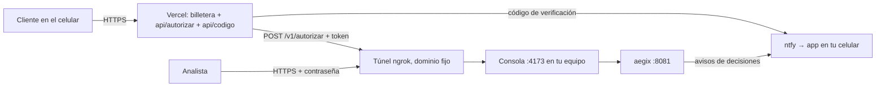

# Desplegar Escudo Yuma, paso a paso

Todo es gratis. Al terminar tendrás:

| Pieza | Dónde corre | Dirección |
| --- | --- | --- |
| Código y documentación | GitHub + GitHub Pages | `https://github.com/Elzepete/Aegix-yuma` y `https://elzepete.github.io/Aegix-yuma/` |
| Billetera Yuma | Vercel (plan Hobby) | `https://<proyecto>.vercel.app` |
| Consola del operador y aegix | tu equipo, detrás de un túnel con dirección fija | `https://<tu-dominio>.ngrok-free.app` |
| Códigos y avisos en el celular | ntfy (app gratuita, sin cuenta) | el tema que elijas |



Haz los pasos 1 a 7 una sola vez, unos días antes. El día de la presentación solo repites el paso 5.

## 1. Subir el código a GitHub

```bash
git push origin main
```

Si pide usuario y contraseña: el usuario es tu cuenta de GitHub y la «contraseña» es un **token**, no tu clave.
Créalo en GitHub → *Settings → Developer settings → Personal access tokens → Fine-grained tokens*, con acceso de
escritura (*Contents: Read and write*) solo a `Aegix-yuma`. Cada `git push` dispara el CI (pestaña *Actions*).

## 2. Publicar los diagramas con GitHub Pages

GitHub muestra los `.html` como código, no como página. Para verlos como página:

1. En el repositorio: *Settings → Pages*.
2. *Source*: **Deploy from a branch**. *Branch*: `main`, carpeta **/docs**. *Save*.
3. En uno o dos minutos queda en `https://elzepete.github.io/Aegix-yuma/`, con enlaces a la arquitectura, la guía
   de presentación y los demás documentos.

## 3. Crear las claves

```bash
openssl rand -hex 24      # YUMA_PANEL_TOKEN: la billetera la presenta ante aegix (en Vercel se llama AEGIX_TOKEN)
openssl rand -base64 12   # YUMA_PANEL_CLAVE: contraseña de la consola en el navegador
openssl rand -hex 6       # final del tema de ntfy, p. ej. yuma-demo-3f9a1c2b7e4d
```

Guárdalas en un gestor de contraseñas. No van al repositorio (`.env*` está ignorado).

## 4. Preparar el celular (ntfy)

ntfy envía notificaciones al celular con una petición HTTP: no hace falta cuenta, número de teléfono ni tarjeta.

1. Instala **ntfy** (Play Store, F-Droid o App Store).
2. Pulsa *+* (suscribirse) y escribe el tema: `yuma-demo-` más lo que generó el paso 3. Servidor: `ntfy.sh`.
3. Tu variable queda así: `NTFY_URL=https://ntfy.sh/yuma-demo-3f9a1c2b7e4d`.

Qué llega al celular:
- **Códigos de verificación** (Vercel): al ingresar a la billetera, en el segundo paso, y cuando aegix pide desafío.
- **Avisos de aegix** (tu equipo): cada decisión sobre la billetera y lo que resuelva el analista.

Los temas de ntfy.sh no tienen contraseña: cualquiera que adivine el nombre los lee. Por eso el nombre es largo y
aleatorio, y por eso solo se envían datos de la demo. Sin `NTFY_URL` todo sigue funcionando: el código aparece en
pantalla como «SMS simulado».

> **¿SMS de verdad?** Twilio da crédito de prueba gratis, pero solo envía a números que verifiques, cada mensaje
> lleva «Sent from your Twilio trial account» y exige registrar el número. ntfy es gratis, ilimitado para una
> demo y llega igual de rápido, por eso es el canal elegido.

## 5. Arrancar aegix, la consola y el túnel (en tu equipo)

**Túnel con dirección fija, una sola vez.** Crea una cuenta gratuita en ngrok.com, descarga `ngrok` en `bin/` (o instálalo en el sistema), ejecuta
`ngrok config add-authtoken <tu-authtoken>` y reclama tu dominio estático gratuito en *Domains*.

**Cada vez que presentes.** Si guardaste las claves en `.env.despliegue` (ignorado por Git), basta con:

```bash
env (grep -v '^#' .env.despliegue) herramientas/iniciar.sh --tunel --demo-limpia   # fish
set -a; source .env.despliegue; set +a; herramientas/iniciar.sh --tunel --demo-limpia   # bash o zsh
```

O define las variables a mano:

```bash
export YUMA_PANEL_TOKEN=<paso 3>
export YUMA_PANEL_CLAVE=<paso 3>
export NGROK_DOMINIO=<tu-dominio>.ngrok-free.app
export NTFY_URL=https://ntfy.sh/yuma-demo-<paso 3>
herramientas/iniciar.sh --tunel --demo-limpia
```

El script compila aegix, compila la consola si hace falta y abre el túnel. Se niega a abrirlo si falta alguna de las
dos claves. `--demo-limpia` archiva la auditoría anterior en `datos/archivo/`, nunca la borra. Ctrl+C apaga todo.
Deja esa terminal abierta durante la presentación.

El túnel apunta a la **consola**, no a aegix. La consola pide contraseña y solo deja pasar tres rutas de la
billetera, que aegix protege con su token: `POST /v1/autorizar`, `GET /v1/autorizar/{id}` y `GET /salud`.

## 6. Desplegar la billetera en Vercel

1. Crea una cuenta en vercel.com con tu GitHub.
2. *Add New → Project* → importa `Aegix-yuma`.
3. *Root Directory*: `yuma-billetera`. *Framework Preset*: `Other`. Sin comando de build.
4. *Environment Variables*:

   | Variable | Valor |
   | --- | --- |
   | `AEGIX_URL` | `https://<tu-dominio>.ngrok-free.app` |
   | `AEGIX_TOKEN` | el mismo valor de `YUMA_PANEL_TOKEN` |
   | `NTFY_URL` | `https://ntfy.sh/yuma-demo-<paso 3>` |

5. *Deploy*. Cada `git push` a `main` vuelve a desplegar solo.

Si cambias una variable, vuelve a desplegar (*Deployments → ⋯ → Redeploy*) para que tome el valor nuevo.

## 7. Comprobar que todo está conectado

```bash
curl https://<tu-dominio>.ngrok-free.app/salud               # {"estado":"ok"}
curl -i https://<tu-dominio>.ngrok-free.app/api/metricas      # 401: la consola pide contraseña
curl https://<proyecto>.vercel.app/api/autorizar              # {"aegix":"en_linea"}
```

Luego, desde el celular:
1. Abre `https://<proyecto>.vercel.app`, elige a Laura y escribe la clave 1111.
2. Te llega una notificación de ntfy con el código. Escríbelo y entras.
3. Envía $50.000 a Andrés: llega «Yuma · Operación aprobada» y la operación aparece en la consola en menos de 2 s.

La consola se abre en `https://<tu-dominio>.ngrok-free.app` con cualquier usuario y la contraseña `YUMA_PANEL_CLAVE`.

## Plan B sin internet

Todo corre en tu equipo, sin Vercel, túnel ni celular; los códigos aparecen en pantalla:

```bash
docker compose up --build                                    # con Docker, o bien:
herramientas/iniciar.sh                                      # aegix :8081 y consola :4173
AEGIX_URL=http://127.0.0.1:8081 node yuma-billetera/dev.mjs  # billetera :3000
```

Si la billetera muestra «aegix sin conexión», no autoriza nada: falla cerrada, a propósito.
