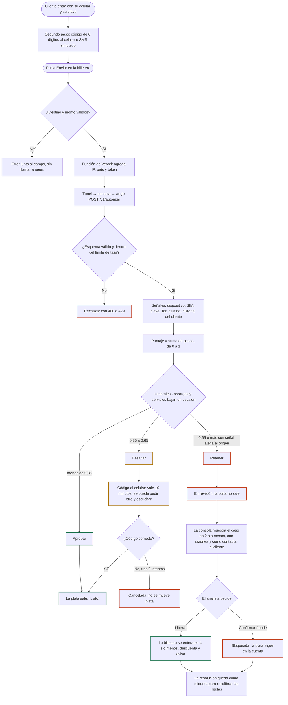
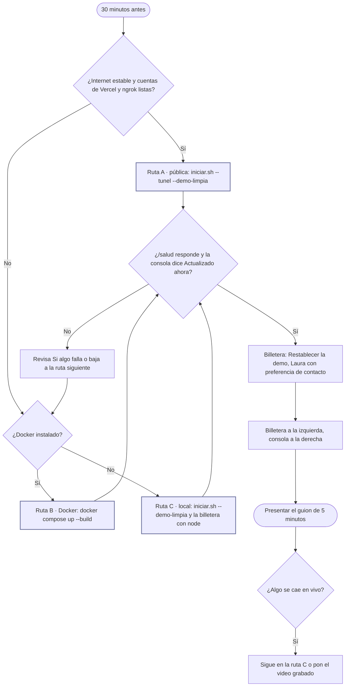

# Flujo de Escudo Yuma

Versión para GitHub de [presentacion.html](presentacion.html), que además trae los comandos, la lista de verificación
y qué hacer si algo falla.

## Cómo funciona una operación

## Cómo ejecutarlo al presentar

| Ruta | Cuándo | Comando |
| --- | --- | --- |
| A · pública | internet, Vercel y ngrok listos | `herramientas/iniciar.sh --tunel --demo-limpia` (con `YUMA_PANEL_TOKEN`, `YUMA_PANEL_CLAVE`, `NGROK_DOMINIO`) |
| B · Docker | sin internet confiable, con Docker | `docker compose up --build` |
| C · local | plan B: Go 1.22+ y Node 20+ | `herramientas/iniciar.sh --demo-limpia` y `AEGIX_URL=http://127.0.0.1:8081 node yuma-billetera/dev.mjs` |
